<p align="center">
  
</p>

<p align="center">
  <a href="https://github.com/MS-X01/dirsweep/actions/workflows/ci.yml"></a>
  
  
  
  
  <a href="LICENSE"></a>
</p>

`dirsweep` removes empty directories, and directories that hold nothing but junk
(`.DS_Store`, `Thumbs.db`, editor swap files, stray `*.log`...). Chains like
`a/b/c/d` go in a single pass. A directory with even one real file in it is left
exactly as it is.

It started as a private script I used for cleaning up after builds, uploads and
old projects. Version 4 is a rewrite with the two things I always wanted from it:
a dry run you can actually trust, and an undo.

<p align="center">
  
</p>

## Install

```bash
git clone https://github.com/MS-X01/dirsweep.git
cd dirsweep
sudo make install          # /usr/local, with man page and shell completion
```

No root? Skip the install and run `bin/dirsweep`, or `make install PREFIX=~/.local`.

Needs bash 4.4+ and GNU `find`/coreutils: any current Linux, WSL. On macOS put
Homebrew's `findutils` and `coreutils` first in `PATH`.

## Use

```bash
dirsweep -d ~/projects            # preview, change nothing
dirsweep -t ~/projects            # clean, and keep an undo record
dirsweep --undo                   # changed your mind
```

More, once you trust it:

```bash
dirsweep -d -v .                          # explain every decision
dirsweep -s .                             # only truly empty dirs, junk counts as content
dirsweep --min-age 14 /srv/uploads        # leave anything touched in the last two weeks
dirsweep -e 'node_modules,\.git' .        # skip these, and everything below them
dirsweep -j '*.dump' .                    # your own junk pattern
dirsweep -i .                             # ask before each one (y / N / a = all / q)
dirsweep ~/a ~/b /srv/c                   # several targets in one run
dirsweep -y -q --json report.json /data   # cron-friendly, with a machine-readable report
```

Run `dirsweep --help` for everything. On a terminal the tool opens with a small
banner; `--no-banner` (or `banner = false` in the config) turns it off, and it is
never printed when output goes to a pipe or a cron job. There is a man page too (`man dirsweep`),
bash and zsh completion, and a config file ([example](examples/dirsweep.conf)).

## What it removes, and what it doesn't

| Directory contains | Result |
|---|---|
| nothing | removed |
| only junk files | removed (junk included), or kept with `-s` |
| junk **and** a real file | kept, junk untouched |
| only empty subdirectories | removed, children first |
| a symlink to a directory | symlink is never followed or removed |
| a mount point | skipped |

The target directory you pass in is never removed itself.

Junk is a short list of file names, and `dirsweep --list-junk` prints it. It is
deliberately conservative: `*.lock`, `*.pid` and `core` are **not** in it, since a
directory holding only `yarn.lock` or a daemon's pid file isn't garbage. `*.log`
is in the list because most people expect it; on a server, combine it with
`--min-age` or `--trash`, or turn the defaults off with `--no-default-junk`.

## Dry runs that match reality

A parent directory only becomes empty once its children are gone, so a naive
preview under-reports. dirsweep tracks what *would* already be gone while it
walks, so `-d` follows the same path as the real run. The test suite checks that
both produce the same count on a tree full of nasty cases.

## Undo

```bash
dirsweep -t ~/projects
dirsweep --undo                       # latest session
dirsweep --restore ~/.local/share/dirsweep/trash/20261105-182338   # a specific one
```

Empty directories carry no data, so they are recorded rather than copied; junk
files are moved aside. Restoring recreates directories with their original mode,
owner and mtime, and never overwrites anything that exists now.
[How it works](docs/HOW_IT_WORKS.md) has the format.

## Safety

- Refuses `/`, `/home`, `/usr`, `/etc` and friends (after resolving symlinks).
- Never deletes without confirmation on a terminal; without one it needs `-y`.
- Doesn't need root. Logs, lock and undo records go under the XDG directories.
- Reads modification times before deleting, so `--min-age` behaves.
- `rmdir` only: a file that appears at the last second makes a removal fail
  instead of being lost.
- Config files are parsed as data, never executed.
- Its own log, report and undo records are never treated as junk.

One known edge: an empty directory that some symlink points at is still
removed, leaving the link dangling. Exclude such directories with `-e`.
The full list of limits is in [docs/HOW_IT_WORKS.md](docs/HOW_IT_WORKS.md#limits).

## Exit status

`0` ok · `1` finished with errors · `2` bad usage or refusal · `130` interrupted

## Tests

```bash
make check        # shellcheck + 126 checks
tests/make_test_env.sh /tmp/playground   # a tree to experiment on
```

The suite builds its own trees under `/tmp` (spaces, newlines, quotes, brackets,
read-only parents, symlinks, backdated chains), and covers dry-run parity,
min-age, exclusions, undo round trips, config handling and the refusals.

## Contributing

Issues and pull requests are welcome, see [CONTRIBUTING.md](CONTRIBUTING.md).
Anything that could delete the wrong thing: [SECURITY.md](SECURITY.md).

## Author

**Mohammad Sadra Naderi**, security researcher and full-stack developer,
founder of ZVitoX.

<p>
  <a href="https://github.com/MS-X01"></a>
  <a href="https://linkedin.com/in/zvitox"></a>
  <a href="https://zvitox.medium.com"></a>
  <a href="https://x.com/Sadra_X01"></a>
</p>

MIT licensed, see [LICENSE](LICENSE).
